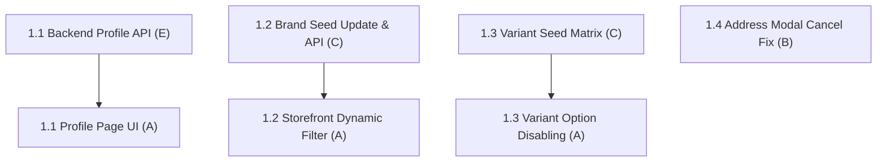

# Fix 1: Customer Account & Storefront UX

> **Status:** Complete (4 / 4 fix items complete)
> **Members:** E (Backend Auth), A (Storefront UI), B (Frontend Auth/Addresses), C (Catalog Seed)
> **Priority:** High
> **Related Phases:** Phase 3 (Auth), Phase 4 (Browsing), Phase 1.4 (Addresses)
> **DB Schema Reference:** [DB_Schema.md](../../Database/DB_Schema.md)

---

## Overview

Fix 1 focuses on customer-facing account experience and storefront catalog accuracy. It addresses the missing customer profile editing capability, accessibility of user profile from navigation, misalignment between storefront brand filters and seeded products, apparel variant combination gaps, and a false success alert bug on the address modal cancellation.

---

## What's Done

- **1.1 Backend Profile & Password APIs (E):** Implemented `PUT /api/auth/profile` and `PUT /api/auth/password` in `authController.js` guarded by `requireAuth`.
- **1.2 Dynamic Brand Filtering (C, A):** Added the active brands endpoint and replaced the storefront's hardcoded list with catalog-derived options, preserving the selected brand in the URL.
- **1.3 Apparel Variant Matrix (C, A):** Completed the seeded apparel color and size matrix and made the storefront selector indicate availability and switch to real combinations.
- **1.4 Address Form Cancel Feedback Fix:** Separated `onSuccess` and `onCancel` callbacks in `AddressForm` to prevent false success alert on modal dismiss or cancel, with clean form state resetting on `/addresses`.
- **1.1 Frontend Profile Management & Navigation (A):** Implemented `/profile` page with personal info and password change tabs guarded by `ProtectedRoute`, and updated `Navbar.tsx` with user account dropdown menu.

---

## Fix Items

| # | Fix Item | Assigned | Depends On | Priority | Status |
|---|----------|----------|------------|----------|--------|
| 1.1 | [Customer Profile Management & Navigation](fix1.1-customer-profile-management.md) | E (API), A (UI) | — | High | Complete |
| 1.2 | [Dynamic Brand Filtering & Seed Catalog Alignment](fix1.2-brand-filtering-dynamic-catalog.md) | C (Backend/Seed), A (UI) | — | Medium | Complete |
| 1.3 | [Apparel Variant Matrix Completeness](fix1.3-apparel-variant-matrix.md) | C (Seed), A (UI) | — | Medium | Complete |
| 1.4 | [Address Form Cancel Feedback Fix](fix1.4-address-form-cancel-feedback.md) | B (Frontend) | — | Low | Complete |

---

## Dependency Flow

---

## Shared Contracts & Notes

- **Profile API Route:** `PUT /api/auth/profile` accepts `{ first_name, last_name, phone }` with `HttpOnly` cookie session.
- **Brand API Route:** `GET /api/products/brands` returns JSON array of unique active brands `string[]`.
