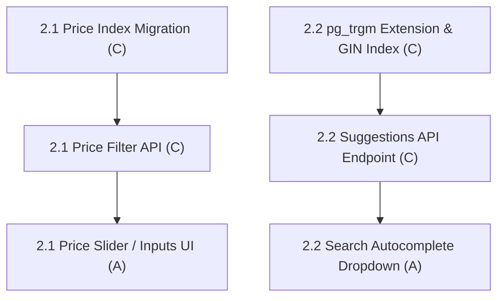

# Fix 2: Search & Filter Performance

> **Status:** In Progress (1 / 2 fix items complete)
> **Members:** C (Backend Products & DB), A (Storefront Search & Catalog UI)
> **Priority:** High
> **Related Phases:** Phase 1.3 (Product Schema), Phase 4 (Catalog Browsing)
> **DB Schema Reference:** [DB_Schema.md](../../Database/DB_Schema.md)

---

## Overview

Fix 2 addresses the product catalog search and filtering engine. It introduces database indexing and query capabilities for price range filtering (min/max price) and search query suggestions/autocomplete, using optimized PostgreSQL indexing patterns (B-Tree composite indexes and `pg_trgm` GIN indexes).

---

## What's Done

- **2.1 Backend (C) & Storefront UI (A):** Added active variant price indexes, validated price range query parameters, matched filtered product counts to returned product cards, and provided responsive Price Range filter controls, quick presets, input validation, and URL query synchronization on the storefront.
- **2.2 Backend (C):** Added `pg_trgm` indexes and `GET /api/products/suggestions?q=...` with input validation, literal wildcard handling, active product filtering, and a six-result limit. Member A's autocomplete UI remains open.

---

## Fix Items

| # | Fix Item | Assigned | Depends On | Priority | Status |
|---|----------|----------|------------|----------|--------|
| 2.1 | [Price Range Filtering & Composite Indexing](fix2.1-price-range-filter-indexing.md) | C (Backend/DB), A (UI) | — | High | Complete |
| 2.2 | [Search Autocomplete & pg_trgm GIN Indexing](fix2.2-search-autocomplete-suggestions.md) | C (Backend/DB), A (UI) | — | High | In Progress (C Complete) |

---

## Dependency Flow

---

## Shared Contracts & DB Migrations

- **Flyway Migration `V22__add_product_price_index.sql`:** Composite index on `product_variants(product_id, price) WHERE is_active = true`.
- **Flyway Migration `V23__add_search_trgm_index.sql`:** `CREATE EXTENSION IF NOT EXISTS pg_trgm;` and GIN index on `products(product_name gin_trgm_ops)`.
- **API Endpoints:**
  - `GET /api/products?min_price=10&max_price=200`
  - `GET /api/products/suggestions?q=app`
