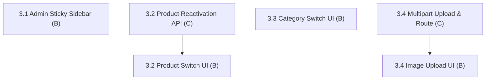

# Fix 3: Admin Catalog & Media Management

> **Status:** Complete (4 / 4 fix items complete)
> **Members:** B (Frontend Admin UI), C (Backend Catalog & Image APIs)
> **Priority:** High
> **Related Phases:** Phase 7 (Admin Dashboard & Inventory), Phase 1.3 (Images & Categories)
> **DB Schema Reference:** [DB_Schema.md](../../Database/DB_Schema.md)

---

## Overview

Fix 3 focuses on the admin management console. It resolves layout usability issues (fixing the scrolling admin sidebar), converts destructive deactivation buttons into active/inactive switches for both products and categories with backend reactivation support, and fixes the product image upload and display pipeline.

---

## What's Done

- **3.1 Admin Sticky Sidebar Layout (B):** Updated desktop `<aside>` classes in `frontend/src/app/admin/layout.tsx` with `sticky top-16 h-[calc(100vh-4rem)] overflow-y-auto` so the admin navigation remains fixed and independently scrollable while main dashboard content scrolls.
- **3.2 Product Active/Inactive Switch & Reactivation API (C, B):** Added backend support for updating `is_active` in `adminProductModel.js`, `adminProductService.js`, `adminProductController.js`, and added route `PATCH /api/admin/products/:id/status`. Replaced the table delete button in `frontend/src/app/admin/products/page.tsx` and product edit header with an interactive `Switch` toggle with optimistic state updates and error revert.
- **3.3 Category Active/Inactive Switch (B):** In `frontend/src/app/admin/categories/page.tsx`, replaced the delete button with an interactive `Switch` toggle component in the category taxonomy tree and added active status controls in the edit modal, supporting immediate toggling between Active and Inactive states with optimistic recursive tree updates and error reverting via `PUT /api/admin/categories/:id`.
- **3.4 Product Image Upload & Route Serving UI (B):** Corrected image URLs across admin edit page (`/admin/products/[id]`) and cart (`/cart`) to use standard `/api/images/:id`, added upload loading state with spinner, added primary image badges, inline sort order inputs, a dedicated deletion confirmation modal, and an informational media configuration note on `/admin/products/new`.
- **3.4 Backend (C):** Multipart uploads now preserve binary bytes, including trailing CRLF, and accept quoted boundaries. The product router also serves the legacy `/api/products/images/:id` image URL.

---

## Fix Items

| # | Fix Item | Assigned | Depends On | Priority | Status |
|---|----------|----------|------------|----------|--------|
| 3.1 | [Admin Sticky Sidebar Layout](fix3.1-admin-sidebar-sticky-layout.md) | B (Frontend) | — | Medium | Complete |
| 3.2 | [Product Active/Inactive Switch & Reactivation API](fix3.2-product-status-toggle.md) | C (Backend), B (Frontend) | — | High | Complete |
| 3.3 | [Category Active/Inactive Switch](fix3.3-category-status-toggle.md) | B (Frontend) | — | Medium | Complete |
| 3.4 | [Product Image Upload & Route Serving Fix](fix3.4-product-image-upload-serving.md) | C (Backend), B (Frontend) | — | High | Complete |

---

## Dependency Flow

---

## Shared Contracts & Notes

- **Product Update Route:** `PUT /api/admin/products/:id` or `PATCH /api/admin/products/:id/status` accepting `{ is_active: boolean }`.
- **Category Update Route:** `PUT /api/admin/categories/:id` accepts `{ is_active: boolean }` (already supported by backend service).
- **Image URL Standard:** All product images must be served from `/api/images/:id` consistently across admin and storefront.
- **Future Cloud Media Storage:** Succeeded by [Fix 6: Cloud Object Storage (AWS S3) & Media Delivery](../Fix6-Cloud-Media-Storage-S3/fix6-cloud-media-storage-s3.md) for complete AWS S3 cloud object storage migration.
