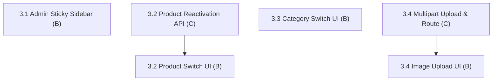

# Fix 3: Admin Catalog & Media Management

> **Status:** Not Started (0 / 4 fix items complete)
> **Members:** B (Frontend Admin UI), C (Backend Catalog & Image APIs)
> **Priority:** High
> **Related Phases:** Phase 7 (Admin Dashboard & Inventory), Phase 1.3 (Images & Categories)
> **DB Schema Reference:** [DB_Schema.md](../../Database/DB_Schema.md)

---

## Overview

Fix 3 focuses on the admin management console. It resolves layout usability issues (fixing the scrolling admin sidebar), converts destructive deactivation buttons into active/inactive switches for both products and categories with backend reactivation support, and fixes the product image upload and display pipeline.

---

## What's Done

- (nothing yet)

---

## Fix Items

| # | Fix Item | Assigned | Depends On | Priority | Status |
|---|----------|----------|------------|----------|--------|
| 3.1 | [Admin Sticky Sidebar Layout](fix3.1-admin-sidebar-sticky-layout.md) | B (Frontend) | — | Medium | Not Started |
| 3.2 | [Product Active/Inactive Switch & Reactivation API](fix3.2-product-status-toggle.md) | C (Backend), B (Frontend) | — | High | Not Started |
| 3.3 | [Category Active/Inactive Switch](fix3.3-category-status-toggle.md) | B (Frontend) | — | Medium | Not Started |
| 3.4 | [Product Image Upload & Route Serving Fix](fix3.4-product-image-upload-serving.md) | C (Backend), B (Frontend) | — | High | Not Started |

---

## Dependency Flow

---

## Shared Contracts & Notes

- **Product Update Route:** `PUT /api/admin/products/:id` or `PATCH /api/admin/products/:id/status` accepting `{ is_active: boolean }`.
- **Category Update Route:** `PUT /api/admin/categories/:id` accepts `{ is_active: boolean }` (already supported by backend service).
- **Image URL Standard:** All product images must be served from `/api/images/:id` consistently across admin and storefront.
