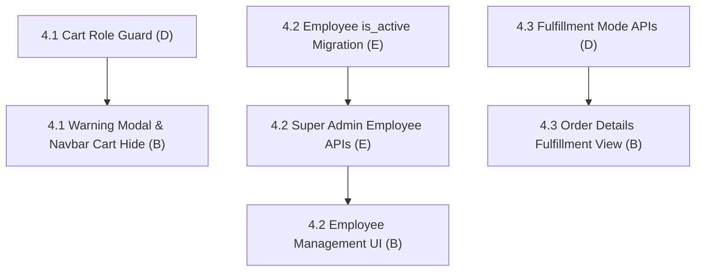

# Fix 4: Role Permissions & Operations

> **Status:** Complete (3 / 3 fix items complete)
> **Members:** E (DevOps/Auth), B (Frontend Admin UI), D (Backend Orders/Deliveries)
> **Priority:** Critical
> **Related Phases:** Phase 3 (Auth), Phase 5 (Cart & Orders), Phase 7 (Admin & Employees)
> **DB Schema Reference:** [DB_Schema.md](../../Database/DB_Schema.md)

---

## Overview

Fix 4 establishes strict separation between customer shopping actions and employee operational responsibilities. It prevents staff and administrators from adding items to cart or checking out (with explanatory modal warnings and navigation restrictions), empowers Super Admins to manage and deactivate employee accounts across DB and backend layers, and formalizes fulfillment workflows between store pickup / gate purchases and courier deliveries.

---

## What's Done

- **4.1 Staff Cart & Purchase Policy Enforcement (B, D):** Completely hid cart icon from navbar for admin/staff accounts, intercepted storefront "Add to Cart" clicks for staff users with the explanatory `StaffPurchaseRestrictedModal` explaining the purchasing policy, added redirect from `/cart` to `/admin`, and verified/standardized all backend cart endpoints to return 403 Forbidden with standard messages for non-customer accounts.
- **4.2 Super Admin Employee Lifecycle & Active Status (E, B):** Created Flyway migration `V24__add_employee_active_status.sql`, updated `DB_Schema.md`, enforced login and middleware rejection for deactivated employees, implemented `PUT /api/admin/employees/:id` & `PATCH /api/admin/employees/:id/status` endpoints with self-deactivation and super admin protection, and implemented Active/Inactive switch toggle & Edit Employee modal in the admin employees UI with self-demotion and self-deactivation protections.
- **4.3 Order Fulfillment Mode Differentiation (D, B):** Updated `backend/src/services/adminOrderService.js` and `adminOrderModel.js` to support distinct status workflows for `store_pickup` (`ready_for_pickup`, `collected`) without requiring courier tracking codes, and `home_delivery` requiring tracking codes for shipment. Added Fulfillment Mode badge in the admin orders list, adapted fulfillment controls across admin modal and dedicated order detail pages for gate pickup vs courier dispatch, and updated customer storefront order details with collection instructions.

---

## Fix Items

| # | Fix Item | Assigned | Depends On | Priority | Status |
|---|----------|----------|------------|----------|--------|
| 4.1 | [Staff Cart & Purchase Policy Enforcement](fix4.1-staff-cart-purchase-restriction.md) | B (UI), D (Backend Cart) | — | High | Complete |
| 4.2 | [Super Admin Employee Management & Deactivation](fix4.2-employee-lifecycle-role-management.md) | E (DB/Backend), B (UI) | — | Critical | Complete |
| 4.3 | [Order Fulfillment: Courier Tracking vs. Store Pickup](fix4.3-order-delivery-mode-fulfillment.md) | D (Backend), B (UI) | — | Medium | Complete |

---

## Dependency Flow

---

## Shared Contracts & DB Migrations

- **Flyway Migration `V24__add_employee_active_status.sql`:** Add `is_active BOOLEAN NOT NULL DEFAULT true` to `employees`.
- **Employee Admin Endpoints:**
  - `GET /api/admin/employees` (already exists, super_admin only)
  - `PUT /api/admin/employees/:id` (update role, first_name, last_name, phone)
  - `PATCH /api/admin/employees/:id/status` (activate / deactivate employee)
- **Delivery Mode Contract:**
  - `store_pickup`: Tracking code hidden / N/A; status transitions: `pending` -> `ready_for_pickup` -> `collected`.
  - `home_delivery`: Tracking code required on ship; status transitions: `pending` -> `processing` -> `shipped` -> `delivered`.

## Fix 8 follow-up

Database integrity and concurrency work is tracked separately in [Fix 8](../Fix8-Database-Integrity-Concurrency/fix8-database-integrity-concurrency.md). The existing completion status above describes the original scope; it does not certify these follow-up protections.

- [Fix 8.3: Cart Uniqueness & Checkout Concurrency](../Fix8-Database-Integrity-Concurrency/fix8.3-cart-checkout-concurrency.md)
- [Fix 8.4: Order Transitions & Payment Event Consistency](../Fix8-Database-Integrity-Concurrency/fix8.4-order-payment-consistency.md)
- [Fix 8.5: Delivery Cardinality & Value Constraints](../Fix8-Database-Integrity-Concurrency/fix8.5-delivery-value-constraints.md)
- [Fix 8.6: Concurrent Super Admin Protection](../Fix8-Database-Integrity-Concurrency/fix8.6-super-admin-protection.md)
- [Fix 8.9: Checkout & Admin Conflict Handling](../Fix8-Database-Integrity-Concurrency/fix8.9-checkout-admin-ui.md)

Read the Fix 8 contracts and prerequisites before implementation. Preserve the existing API and UI behavior unless an explicit contract decision documents a change; update both trackers only after verification.
