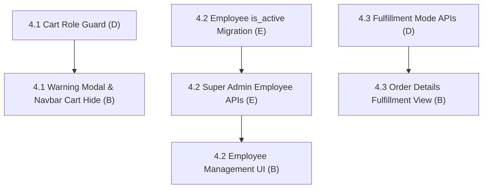

# Fix 4: Role Permissions & Operations

> **Status:** In Progress (0 / 3 fix items complete)
> **Members:** E (DevOps/Auth), B (Frontend Admin UI), D (Backend Orders/Deliveries)
> **Priority:** Critical
> **Related Phases:** Phase 3 (Auth), Phase 5 (Cart & Orders), Phase 7 (Admin & Employees)
> **DB Schema Reference:** [DB_Schema.md](../../Database/DB_Schema.md)

---

## Overview

Fix 4 establishes strict separation between customer shopping actions and employee operational responsibilities. It prevents staff and administrators from adding items to cart or checking out (with explanatory modal warnings and navigation restrictions), empowers Super Admins to manage and deactivate employee accounts across DB and backend layers, and formalizes fulfillment workflows between store pickup / gate purchases and courier deliveries.

---

## What's Done

- **4.1 Staff Cart & Purchase Policy Enforcement (D):** Implemented strict customer-only guards across all cart endpoints (`GET /api/cart`, `POST /api/cart/items`, `PUT /api/cart/items/:id`, `DELETE /api/cart/items/:id`), returning standard `403 Forbidden` with `{ error: 'forbidden', message: 'Administrative and staff accounts cannot create or modify shopping carts' }` when staff/admin accounts access the cart.
- **4.2 Super Admin Employee Lifecycle & Active Status (E):** Created Flyway migration `V24__add_employee_active_status.sql`, updated `DB_Schema.md`, enforced login and middleware rejection for deactivated employees, and implemented `PUT /api/admin/employees/:id` & `PATCH /api/admin/employees/:id/status` endpoints with self-deactivation and super admin protection.
- **4.3 Order Fulfillment Mode Differentiation (D):** Updated `backend/src/services/adminOrderService.js` and `adminOrderModel.js` to support distinct status workflows for `store_pickup` (`ready_for_pickup`, `collected`) without requiring courier tracking codes, and `home_delivery` requiring tracking codes for shipment. Explicitly exposed `delivery_mode` in order summary list and details endpoints in `adminOrderController.js`.

---

## Fix Items

| # | Fix Item | Assigned | Depends On | Priority | Status |
|---|----------|----------|------------|----------|--------|
| 4.1 | [Staff Cart & Purchase Policy Enforcement](fix4.1-staff-cart-purchase-restriction.md) | B (UI), D (Backend Cart) | — | High | In Progress |
| 4.2 | [Super Admin Employee Management & Deactivation](fix4.2-employee-lifecycle-role-management.md) | E (DB/Backend), B (UI) | — | Critical | In Progress |
| 4.3 | [Order Fulfillment: Courier Tracking vs. Store Pickup](fix4.3-order-delivery-mode-fulfillment.md) | D (Backend), B (UI) | — | Medium | In Progress |

---

## Dependency Flow

---

## Shared Contracts & DB Migrations

- **Flyway Migration `V24__add_employee_active_status.sql`:** Add `is_active BOOLEAN NOT NULL DEFAULT true` to `employees`.
- **Employee Admin Endpoints:**
  - `GET /api/admin/employees` (already exists, super_admin only)
  - `PUT /api/admin/employees/:id` (update role, first_name, last_name, phone)
  - `PATCH /api/admin/employees/:id/status` (activate / deactivate employee)
- **Delivery Mode Contract:**
  - `store_pickup`: Tracking code hidden / N/A; status transitions: `pending` -> `ready_for_pickup` -> `collected`.
  - `home_delivery`: Tracking code required on ship; status transitions: `pending` -> `processing` -> `shipped` -> `delivered`.
