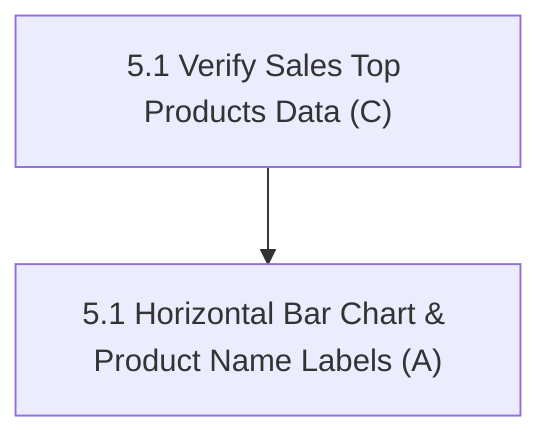

# Fix 5: Analytics & Reports Visuals

> **Status:** Not Started (0 / 1 fix items complete)
> **Members:** A (Storefront & Reports UI), C (Backend Sales & Analytics Queries)
> **Priority:** Medium
> **Related Phases:** Phase 9 (Reports & Analytics)
> **DB Schema Reference:** [DB_Schema.md](../../Database/DB_Schema.md)

---

## Overview

Fix 5 enhances business intelligence and reporting readability in the admin reports dashboard. It fixes the "Top Performing Products" bar chart to directly display readable product names instead of numeric indexes or compressed ticks.

---

## What's Done

- (nothing yet)

---

## Fix Items

| # | Fix Item | Assigned | Depends On | Priority | Status |
|---|----------|----------|------------|----------|--------|
| 5.1 | [Top Performing Products Chart Display](fix5.1-top-performing-products-chart.md) | A (UI), C (Reports Backend) | — | Medium | Not Started |

---

## Dependency Flow

