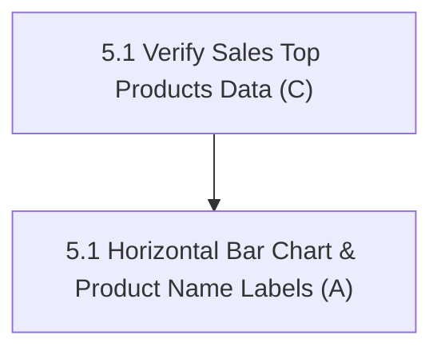

# Fix 5: Analytics & Reports Visuals

> **Status:** Complete (1 / 1 fix items complete)
> **Members:** A (Storefront & Reports UI), C (Backend Sales & Analytics Queries)
> **Priority:** Medium
> **Related Phases:** Phase 9 (Reports & Analytics)
> **DB Schema Reference:** [DB_Schema.md](../../Database/DB_Schema.md)

---

## Overview

Fix 5 enhances business intelligence and reporting readability in the admin reports dashboard. It fixes the "Top Performing Products" bar chart to directly display readable product names instead of numeric indexes or compressed ticks.

---

## What's Done

- **5.1 Top Performing Products (A, C):** Confirmed product names in the API response and updated both report charts with horizontal revenue bars, readable name labels, and full names in tooltips.

---

## Fix Items

| # | Fix Item | Assigned | Depends On | Priority | Status |
|---|----------|----------|------------|----------|--------|
| 5.1 | [Top Performing Products Chart Display](fix5.1-top-performing-products-chart.md) | A (UI), C (Reports Backend) | — | Medium | Complete |

---

## Dependency Flow

## Fix 8 follow-up

Database integrity and concurrency work is tracked separately in [Fix 8](../Fix8-Database-Integrity-Concurrency/fix8-database-integrity-concurrency.md). The existing completion status above describes the original scope; it does not certify these follow-up protections.

- [Fix 8.10: Storefront & Report Regression Verification](../Fix8-Database-Integrity-Concurrency/fix8.10-storefront-report-regression.md)

Read the Fix 8 contracts and prerequisites before implementation. Preserve the existing API and UI behavior unless an explicit contract decision documents a change; update both trackers only after verification.
