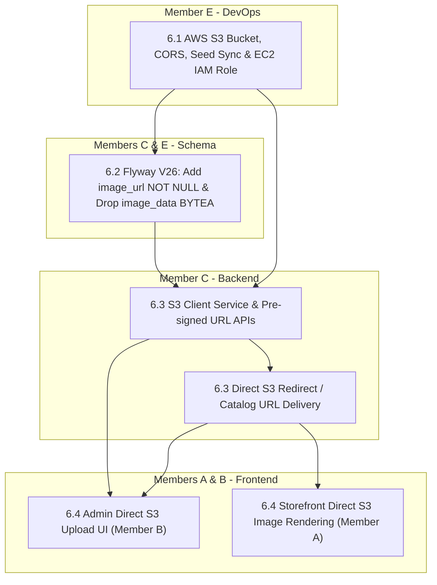

# Fix 6: Cloud Object Storage (AWS S3) & Media Delivery

> **Status:** Complete (4 / 4 fix items complete)
> **Members:** E (DevOps & Architecture), C (Backend Catalog & Image APIs), B (Frontend Admin UI), A (Frontend Storefront UI)  
> **Priority:** High  
> **Related Phases:** [Phase 1.6: Product Schema](../../Phases/Phase1-Project-Foundation/phase1.6-product-schema.md), [Phase 4.2: Image Serving Endpoint](../../Phases/Phase4-Product-Catalog-Browsing/phase4.2-image-serving-endpoint.md), [Phase 7.1: Product Variant & Image Admin APIs](../../Phases/Phase7-Inventory-Admin-Dashboard/phase7.1-product-variant-image-admin-apis.md), [Phase 10.6: Production Deployment](../../Phases/Phase10-Polish-Testing-Deployment/phase10.6-production-deployment.md)  
> **Related Fixes:** [Fix 3.4: Product Image Upload & Route Serving Fix](../Fix3-Admin-Catalog-Media/fix3.4-product-image-upload-serving.md)  
> **DB Schema Reference:** [DB_Schema.md](../../Database/DB_Schema.md) (table: `product_images`)  
> **Cloud Infrastructure Reference:** [aws-infrastructure.md](../../Deployment/aws-infrastructure.md)  

---

## Overview

Following formal approval from the course lecturer, BrightBuy is completely transitioning from storing raw binary image data directly inside PostgreSQL (`BYTEA`) to cloud object storage using **Amazon Web Services (AWS) Simple Storage Service (S3)**.

The legacy `BYTEA` column is being **completely retired and dropped from the database**. The database will exclusively store clean, lightweight object links (`image_url VARCHAR(500) NOT NULL`), keeping PostgreSQL fast, relational, and free of binary bloat.

### Architectural Goals & Requirements
1. **Clean Cloud Object Storage (No BYTEA Bloat):**
   - 100% of image assets reside in the AWS S3 bucket `brightbuy-media-storage-695945476492`.
   - The database stores only direct S3 links (`image_url VARCHAR(500)`).
   - Migration `V26__replace_image_data_with_image_url.sql` drops `image_data BYTEA` completely.
2. **Seed Asset Cutover:**
   - Existing 40 seeded demo product images are uploaded directly to S3 under `products/{productId}/`.
   - `backend/db/seed/04_products.sql` is updated to insert real S3 URLs instead of inline base64 blobs.
3. **Security & Zero Hardcoded Secrets:**
   - The production AWS EC2 instance (`18.208.53.186`) communicates with S3 using an **IAM Instance Profile Role** via AWS Instance Metadata Service (IMDSv2). No `AWS_ACCESS_KEY_ID` or `AWS_SECRET_ACCESS_KEY` secrets are stored in `.env.prod` or git repositories.
4. **Optimized Direct Uploads:**
   - Admin image uploads use **Pre-signed S3 URLs**, uploading binary files directly from the browser to S3. The Express Node.js process never buffers multi-megabyte image payloads in memory.

---

## Fix Items

| # | Fix Item | Assigned | Depends On | Priority | Status |
|---|----------|----------|------------|----------|--------|
| 6.1 | [AWS S3 Infrastructure, Bucket Security & EC2 IAM Integration](fix6.1-s3-infrastructure-bucket-iam.md) | **E** (DevOps) | — | Critical | Complete |
| 6.2 | [Database Schema Migration & S3 Seed Cutover](fix6.2-s3-schema-migration-seed-cutover.md) | **C** (DB), **E** (Architecture) | 6.1 | High | Complete |
| 6.3 | [Backend S3 Service & Pre-signed Upload APIs](fix6.3-backend-s3-service-upload-apis.md) | **C** (Backend) | 6.1, 6.2 | High | Complete |
| 6.4 | [Storefront & Admin Direct Image Delivery & Upload UI](fix6.4-storefront-admin-image-delivery-ui.md) | **A** (Storefront), **B** (Admin) | 6.3 | Medium | Complete |

---

## Dependency Flow



---

## Shared Contracts & Architectural Rules

1. **Storage Identifier & URL Format:**
   - S3 Object Keys follow structured naming:
     ```text
     products/{productId}/{uuid}-{timestamp}.{ext}
     ```
   - Standard URL format stored in database:
     ```text
     https://brightbuy-media-storage-695945476492.s3.us-east-1.amazonaws.com/products/{productId}/{key}
     ```
2. **Database Clean Schema:**
   - Table `product_images`:
     ```sql
     CREATE TABLE product_images (
       image_id   SERIAL PRIMARY KEY,
       product_id INT NOT NULL REFERENCES products(product_id) ON DELETE CASCADE,
       image_url  VARCHAR(500) NOT NULL,
       sort_order INT NOT NULL DEFAULT 0,
       is_primary BOOLEAN NOT NULL DEFAULT false,
       created_at TIMESTAMP DEFAULT CURRENT_TIMESTAMP
     );
     ```
   - No `image_data BYTEA` column exists in the database schema.
3. **Delivery Mechanism:**
   - Storefront and Admin interfaces load images directly from the S3 URL (or CloudFront CDN distribution).
   - `/api/images/:id` issues a `302 Found` redirect to the S3 URL or returns the direct `image_url` in product JSON payloads.
4. **Environment Variables:**
   - `AWS_REGION=us-east-1`
   - `AWS_S3_BUCKET_NAME=brightbuy-media-storage-695945476492`
