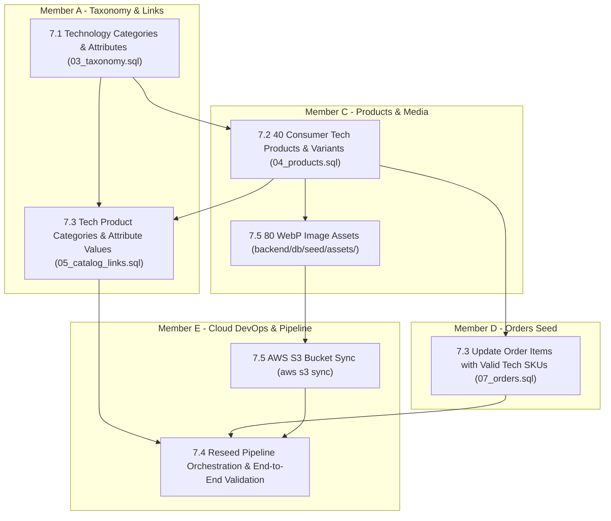

# Fix 7: Consumer Technology Catalog Specialization

> **Status:** In Progress (4 / 5 fix items complete)  
> **Members:** A (Frontend Storefront & Taxonomy), C (Backend Products & Seed Data), D (Backend Orders & Order Seeds), E (DevOps, Database Tooling & Reseed Orchestration), B (Frontend Admin UI)  
> **Priority:** High  
> **Related Phases:** [Phase 1.5: Catalog Taxonomy Schema](../../Phases/Phase1-Project-Foundation/phase1.5-catalog-taxonomy-schema.md), [Phase 1.6: Product Schema](../../Phases/Phase1-Project-Foundation/phase1.6-product-schema.md), [Phase 1.7: Order Schema](../../Phases/Phase1-Project-Foundation/phase1.7-order-payment-delivery-schema.md), [Phase 4: Product Catalog & Browsing](../../Phases/Phase4-Product-Catalog-Browsing/phase4-product-catalog-browsing.md)  
> **Related Fixes:** [Fix 1.2: Dynamic Brand Filtering](../Fix1-Customer-Account-Storefront/fix1.2-brand-filtering-dynamic-catalog.md), [Fix 1.3: Apparel Variant Matrix](../Fix1-Customer-Account-Storefront/fix1.3-apparel-variant-matrix.md), [Fix 6: Cloud Object Storage (AWS S3)](../Fix6-Cloud-Media-Storage-S3/fix6-cloud-media-storage-s3.md)  
> **DB Schema Reference:** [DB_Schema.md](../../Database/DB_Schema.md) (tables: `categories`, `products`, `product_variants`, `product_images`, `product_categories`, `variant_attributes`, `variant_attribute_values`, `order_items`)  

---

## Overview

BrightBuy is repositioning and specializing its commercial storefront and inventory catalog to **exclusively offer consumer technology and electronic products** (such as laptops, smartphones, tablets, audio/earbuds, smart wearables, PC peripherals, and tech accessories).

Previously, the demo catalog contained mixed merchandise across Home Appliances (air purifiers, vacuum cleaners, kitchen gadgets) and Apparel (shirts, jackets, dresses). Fix 7 systematically overhauls the seed catalog, category taxonomy, variant attribute matrix, and historical order references so that 100% of the platform's products, search results, and category trees represent high-quality technology items.

---

## Architectural Goals & Scope

1. **Pure Consumer Technology Taxonomy:**
   - Overhaul `03_taxonomy.sql` to replace obsolete non-tech categories (*Home Appliances*, *Kitchen*, *Cleaning*, *Apparel*, *Men's Clothing*, *Women's Clothing*) with dedicated technology category trees (*Smartphones & Tablets*, *Laptops & Computers*, *Audio & Headphones*, *Smart Wearables & IoT*, *PC Gaming & Accessories*).
   - Reconfigure variant attributes to focus on technology specifications (e.g. *Storage*, *RAM*, *Color*, *Connectivity*).

2. **100% Technology Product Catalog & Variants:**
   - Overhaul `04_products.sql` to replace all 24 non-tech product records (`HAP-*`, `KIT-*`, `CLN-*`, `APP-*`, `MCL-*`, `WCL-*`) with 24 modern consumer tech devices.
   - Maintain 40 comprehensive tech products with realistic tech variant SKUs, specifications, pricing, stock levels, and AWS S3 media links (`image_url`).

3. **Cloud Media Assets & S3 Image Delivery:**
   - Overhaul `backend/db/seed/assets/` folders `17` through `40` with optimized 800x800 WebP tech imagery (`primary.webp` and `secondary.webp`).
   - Sync all 80 asset files to AWS S3 bucket `s3://brightbuy-media-storage-695945476492/products/` with public-read permissions and immutable cache headers.
   - Insert primary and secondary image URLs into `04_products.sql` for rich storefront galleries.

4. **Referential Integrity & Seed Consistency:**
   - Update `05_catalog_links.sql` so all 40 products correctly map into tech categories, and all variants have proper attribute values.
   - Update `07_orders.sql` historical order items to reference valid tech variant SKUs, preventing foreign key check failures during reseed.

5. **Automated Reseed Pipeline & Verification:**
   - Orchestrate and verify clean reseed execution order in Docker and on the AWS deployment instance without schema drift or broken database references.

---

## Fix Items

| # | Fix Item | Assigned | Depends On | Priority | Status |
|---|----------|----------|------------|----------|--------|
| 7.1 | [Technology Taxonomy & Category Hierarchy Restructuring](fix7.1-technology-taxonomy-hierarchy.md) | **A** (Taxonomy & Navigation) | — | High | Complete |
| 7.2 | [Technology Product Catalog, Variant & Media Seed Alignment](fix7.2-technology-product-catalog-seed.md) | **C** (Products & Variants) | 7.1 | High | Complete |
| 7.3 | [Catalog Links, Attribute Values & Order History Referential Integrity](fix7.3-catalog-links-order-seed-integrity.md) | **A** (Catalog Links), **D** (Order Seeds) | 7.1, 7.2 | High | Complete |
| 7.4 | [Database Reseed Orchestration, Flyway Verification & Storefront Validation](fix7.4-database-reseed-pipeline-verification.md) | **E** (DevOps), **A** (Storefront), **B** (Admin) | 7.1, 7.2, 7.3, 7.5 | High | In Progress |
| 7.5 | [Cloud Media Assets, Tech Imagery & S3 Bucket Synchronization](fix7.5-cloud-media-assets-s3-sync.md) | **E** (Cloud/DevOps), **C** (Media Assets) | 7.2 | High | Complete |

---

## Dependency Flow

---

## Shared Contracts & Seed Standards

1. **Seed Execution Order:**
   - `01_identity.sql` → `02_customers.sql` → `03_taxonomy.sql` → `04_products.sql` → `05_catalog_links.sql` → `06_carts.sql` → `07_orders.sql`.
2. **Natural Key Lookup Rule:**
   - Seed scripts must **never hardcode serial primary keys**. Lookup products by `base_sku`, variants by `variant_sku`, categories by `category_name`, and attributes by `attribute_name`.
3. **AWS S3 Image URI Standard:**
   - Product images must follow the approved S3 key convention:
     `https://brightbuy-media-storage-695945476492.s3.us-east-1.amazonaws.com/products/{productId}/{filename}.webp`
4. **No Schema Changes Required:**
   - The underlying relational database schema (`V1` through `V26`) fully supports flexible taxonomy, products, variants, and cloud media URLs without needing DDL schema modifications.

---

## Affected Files Summary

- `backend/db/seed/03_taxonomy.sql` (Member A)
- `backend/db/seed/04_products.sql` (Member C)
- `backend/db/seed/05_catalog_links.sql` (Member A)
- `backend/db/seed/07_orders.sql` (Member D)
- `frontend/src/app/products/page.tsx` (Member A)
- `frontend/src/app/categories/page.tsx` (Member A)
- `frontend/src/app/admin/products/page.tsx` (Member B)
