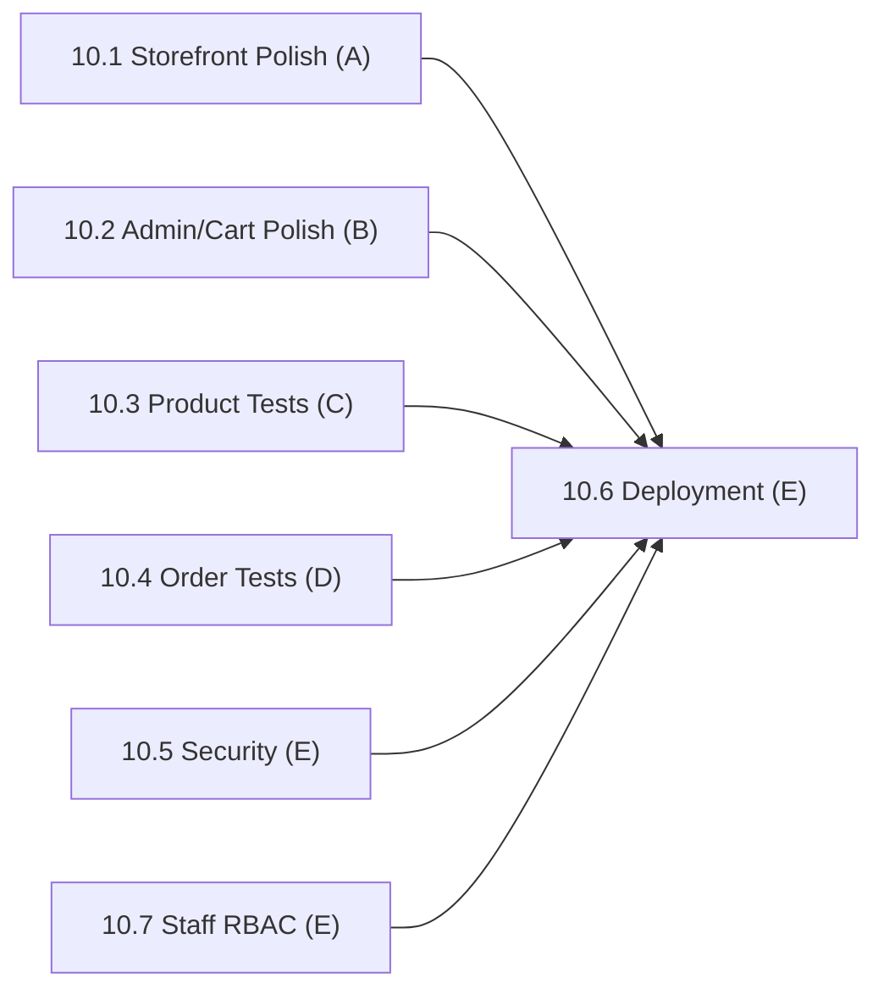

# Phase 10: Polish, Testing & Deployment

> **Status:** In Progress (6 / 7 subphases complete)
> **Lead:** E (deployment)
> **Members:** A, B, C, D, E — each polishes and tests their own area
> **Phase Dependencies:** All previous phases should be substantially complete
> **DB Schema Reference:** [DB_Schema.md](../../Database/DB_Schema.md)

---

## Overview

Final quality pass and go-live preparation. Each member polishes their own area: responsive design, error handling, loading states, validation, and tests. E leads security hardening and production deployment.

---

## What's Done

- **10.1 Storefront Polish (A):** Responsive audit across all storefront pages, custom modern landing page, mobile navigation and drawer, custom 404 page (`not-found.tsx`), card & detail skeleton loaders, error retry UI, Add-to-Cart micro-interaction with feedback, and SEO metadata.
- **10.2 Admin, Cart & Checkout Polish (B):** Responsive design audit on auth, admin dashboard, cart, and checkout; mobile drawer for admin; per-item loading and smooth transition states for cart; inline validation and error alerts replacing browser dialogs; empty states for cart, orders, addresses, and admin tables; resolved Next.js TypeScript build.
- **10.3 Product Backend Validation & Tests (C):** Added request validation and service/controller tests for product CRUD, category cycles, images, admin inputs, and reports; repaired the backend test scripts and lock file. Both test suites pass.
- **10.4 Order Backend Validation & Tests (D):** Standardized input validation and shared error responses (`{ error, message, statusCode }`) across cart, address, order, payment, and delivery endpoints; verified atomic stock deduction and deadlock prevention via sorted row locks; added 34 automated unit and integration tests across two suites covering happy paths, rollback edge cases, COD and Card flows, Lemon Squeezy webhook handling, and non-blocking email notifications; all 6 backend test suites (69 tests) pass.
- **10.5 Security Hardening (E):** Implemented Helmet.js HTTP security headers and CSP, configured restrictive CORS with frontend origin and credentials, added `express-rate-limit` to auth and API endpoints, performed SQL injection audit verifying parameterized queries across all endpoints, standardized 404 and global error handlers to `{ error, message, statusCode }`, and added a 21-test automated suite (`jest` + `supertest`) covering registration, login, refresh rotation, logout, `requireAuth`, and `requireRole`.
- **10.7 Staff Role-Based Access Control (RBAC) (E):** Implemented database migration V21 adding operational sub-roles to employees (`super_admin`, `inventory_manager`, `order_dispatcher`, `catalog_manager`, `analyst`), extended JWT auth middleware with `requireStaffRole` least-privilege guards across all administrative and analytics endpoints, updated auth store, dynamic sidebar navigation in admin layout with custom access restriction view, role selector in employee onboarding UI, and automated unit tests for role guards.

---

## Subphases

| # | Subphase | Assigned | Depends On | Status |
|---|----------|----------|------------|--------|
| 10.1 | [Storefront Polish](phase10.1-storefront-polish.md) | A | 4.3, 4.4, 9.4 | Complete |
| 10.2 | [Admin, Cart & Checkout Polish](phase10.2-admin-cart-checkout-polish.md) | B | 5.6, 6.4, 7.6 | Complete |
| 10.3 | [Product Backend Validation & Tests](phase10.3-product-backend-validation-tests.md) | C | Phase 4, 7, 9 APIs | Complete |
| 10.4 | [Order Backend Validation & Tests](phase10.4-order-backend-validation-tests.md) | D | Phase 5, 6, 8 APIs | Complete |
| 10.5 | [Security Hardening](phase10.5-security-hardening.md) | E | Phase 3, 6.1 | Complete |
| 10.6 | [Production Deployment](phase10.6-production-deployment.md) | E | 10.1 – 10.5 | In Progress |
| 10.7 | [Staff Role-Based Access Control (RBAC)](phase10.7-staff-rbac.md) | E | 10.2, 10.5 | Complete |

---

## Dependency Flow



10.1 – 10.5 and 10.7 run in parallel.

---

## Shared Contract: Error Response Format

All backend endpoints (C, D, E) must return errors in this shape:

```json
{ "error": "Short machine-readable message", "message": "Human-readable detail", "statusCode": 400 }
```

---

## Key Decisions & Notes

_Record any implementation decisions, trade-offs, or deviations from the plan here._

---

## Related Fixes & Patches Track

User testing, end-to-end integration audits, and operational feedback revealed targeted refinements across the platform. These are formally planned and tracked in the dedicated **[Fixes & Patches Master Plan](../../Fixes/overallplan.md)**:
- **[Fix 1: Customer Account & Storefront Polish](../../Fixes/Fix1-Customer-Account-Storefront/fix1-customer-account-storefront.md)** (Fixes 1.1 – 1.4: profile management, dynamic brands, complete apparel variant matrix, checkout address feedback).
- **[Fix 2: Search & Filter Performance](../../Fixes/Fix2-Search-Filter-Performance/fix2-search-filter-performance.md)** (Fixes 2.1 – 2.2: price range dual-slider + V22 composite index, debounced search autocomplete + V23 trigram GIN index).
- **[Fix 3: Admin Catalog & Media](../../Fixes/Fix3-Admin-Catalog-Media/fix3-admin-catalog-media.md)** (Fixes 3.1 – 3.4: sticky admin sidebar, product/category status switches & reactivation, multipart image upload & `/api/images/:id` route fix).
- **[Fix 4: Role Permissions & Operations](../../Fixes/Fix4-Role-Permissions-Operations/fix4-role-permissions-operations.md)** (Fixes 4.1 – 4.3: staff cart purchase restriction, Super Admin employee deactivation & V24 migration, store pickup vs courier tracking codes).
- **[Fix 5: Analytics & Reports Visuals](../../Fixes/Fix5-Analytics-Reports-Visuals/fix5-analytics-reports-visuals.md)** (Fix 5.1: real product name labels and tooltips on top performing products chart).


