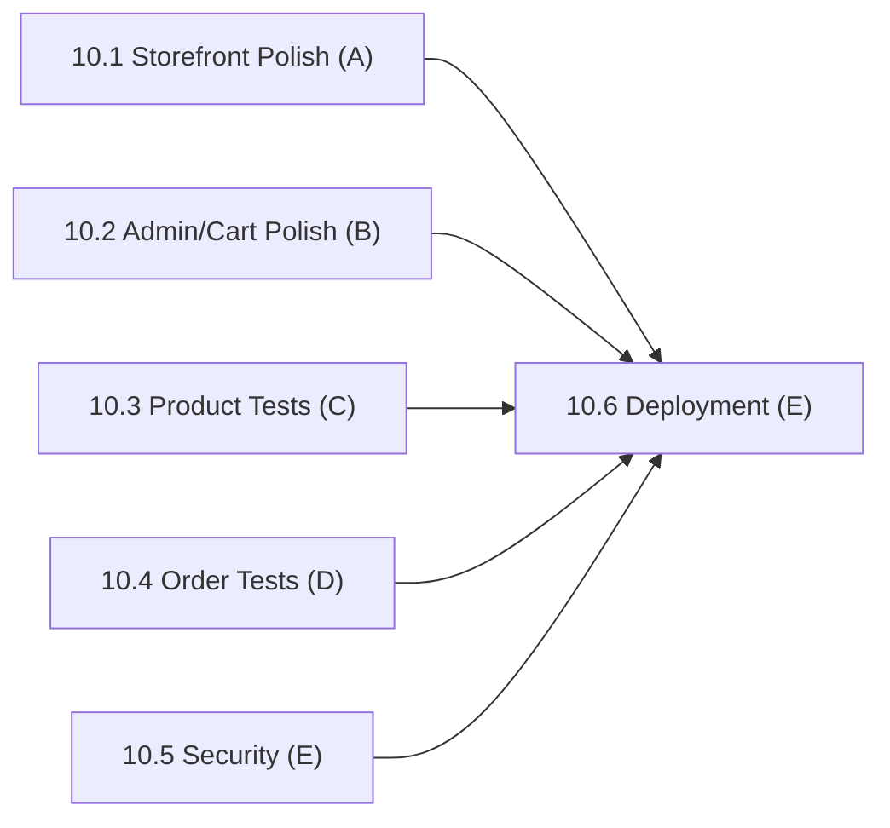

# Phase 10: Polish, Testing & Deployment

> **Status:** In Progress (4 / 6 subphases complete)
> **Lead:** E (deployment)
> **Members:** A, B, C, D, E — each polishes and tests their own area
> **Phase Dependencies:** All previous phases should be substantially complete
> **DB Schema Reference:** [DB_Schema.md](../../Database/DB_Schema.md)

---

## Overview

Final quality pass and go-live preparation. Each member polishes their own area: responsive design, error handling, loading states, validation, and tests. E leads security hardening and production deployment.

---

## What's Done

- **10.1 Storefront Polish (A):** Responsive audit across all storefront pages, custom modern landing page, mobile navigation and drawer, custom 404 page (`not-found.tsx`), card & detail skeleton loaders, error retry UI, Add-to-Cart micro-interaction with feedback, and SEO metadata.
- **10.3 Product Backend Validation & Tests (C):** Added request validation and service/controller tests for product CRUD, category cycles, images, admin inputs, and reports; repaired the backend test scripts and lock file. Both test suites pass.
- **10.4 Order Backend Validation & Tests (D):** Standardized input validation and shared error responses (`{ error, message, statusCode }`) across cart, address, order, payment, and delivery endpoints; verified atomic stock deduction and deadlock prevention via sorted row locks; added 34 automated unit and integration tests across two suites covering happy paths, rollback edge cases, COD and Card flows, Lemon Squeezy webhook handling, and non-blocking email notifications; all 6 backend test suites (69 tests) pass.
- **10.5 Security Hardening (E):** Implemented Helmet.js HTTP security headers and CSP, configured restrictive CORS with frontend origin and credentials, added `express-rate-limit` to auth and API endpoints, performed SQL injection audit verifying parameterized queries across all endpoints, standardized 404 and global error handlers to `{ error, message, statusCode }`, and added a 21-test automated suite (`jest` + `supertest`) covering registration, login, refresh rotation, logout, `requireAuth`, and `requireRole`.

---

## Subphases

| # | Subphase | Assigned | Depends On | Status |
|---|----------|----------|------------|--------|
| 10.1 | [Storefront Polish](phase10.1-storefront-polish.md) | A | 4.3, 4.4, 9.4 | Complete |
| 10.2 | [Admin, Cart & Checkout Polish](phase10.2-admin-cart-checkout-polish.md) | B | 5.6, 6.4, 7.6 | Not Started |
| 10.3 | [Product Backend Validation & Tests](phase10.3-product-backend-validation-tests.md) | C | Phase 4, 7, 9 APIs | Complete |
| 10.4 | [Order Backend Validation & Tests](phase10.4-order-backend-validation-tests.md) | D | Phase 5, 6, 8 APIs | Complete |
| 10.5 | [Security Hardening](phase10.5-security-hardening.md) | E | Phase 3, 6.1 | Complete |
| 10.6 | [Production Deployment](phase10.6-production-deployment.md) | E | 10.1 – 10.5 | Not Started |

---

## Dependency Flow



10.1 – 10.5 run fully in parallel.

---

## Shared Contract: Error Response Format

All backend endpoints (C, D, E) must return errors in this shape:

```json
{ "error": "Short machine-readable message", "message": "Human-readable detail", "statusCode": 400 }
```

---

## Key Decisions & Notes

_Record any implementation decisions, trade-offs, or deviations from the plan here._

