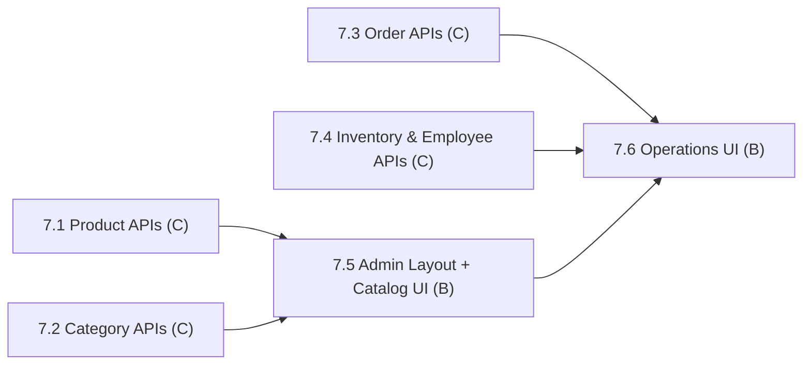

# Phase 7: Inventory & Admin Dashboard

> **Status:** Complete (6 / 6 subphases complete)
> **Members:** C (backend admin APIs), B (frontend admin UI)
> **Phase Dependencies:** Phase 3 (role guards) and Phase 4 (product APIs). 7.3 also needs Phase 5 (orders).
> **DB Schema Reference:** [DB_Schema.md](../../Database/DB_Schema.md)

---

## Overview

Management tools for employees and administrators. C builds admin-only APIs for product/category/variant CRUD, inventory, order management, and employee administration. B builds the admin dashboard UI. All admin endpoints require the `admin` role.

---

## What's Done

- **7.1 Product, Variant & Image Admin APIs:** Added admin-protected product CRUD, image upload/update/delete, and variant CRUD endpoints under `/api/admin`.
- **7.2 Category Admin APIs:** Added admin-protected category tree CRUD with soft delete and circular hierarchy protection.
- **7.3 Order & Delivery Admin APIs:** Added order filtering, status transition rules, and delivery courier update endpoints.
- **7.4 Inventory & Employee Admin APIs:** Added stock level monitoring, audited stock adjustments with reason logging, and employee user account registration.
- **7.5 Admin Layout & Catalog Management UI:** Created admin shell with sidebar navigation, category tree manager, product catalog table with search and soft delete, product creation form, and full product editor with media upload and variant matrix.
- **7.6 Operations Admin UI (Orders, Inventory, Employees):** Created order management table with multi-filter and status controls, delivery updates, inventory dashboard with low-stock alerts and audited adjustment modal, and employee administration page.

---

## Subphases

| # | Subphase | Assigned | Depends On | Status |
|---|----------|----------|------------|--------|
| 7.1 | [Product, Variant & Image Admin APIs](phase7.1-product-variant-image-admin-apis.md) | C | 3.2, 4.1 | Complete |
| 7.2 | [Category Admin APIs](phase7.2-category-admin-apis.md) | C | 3.2 | Complete |
| 7.3 | [Order & Delivery Admin APIs](phase7.3-order-delivery-admin-apis.md) | C | 3.2, 5.3 | Complete |
| 7.4 | [Inventory & Employee Admin APIs](phase7.4-inventory-employee-admin-apis.md) | C | 3.2 | Complete |
| 7.5 | [Admin Layout & Catalog Management UI](phase7.5-admin-layout-catalog-management-ui.md) | B | 3.4, 7.1, 7.2 | Complete |
| 7.6 | [Operations Admin UI (Orders, Inventory, Employees)](phase7.6-operations-admin-ui.md) | B | 7.3, 7.4, 7.5 | Complete |

---

## Dependency Flow

B can start the admin layout and forms in 7.5 with mock data while C builds the APIs.

---

## Key Decisions & Notes

- 7.1 uses a route-local multipart parser for image uploads so no new dependency is required in the current environment. Uploaded image bytes are validated by magic bytes before inserting into `product_images.image_data`.

---

## Related Fixes & Patches

Admin operations and inventory workflows are enhanced and resolved by the following post-development fix items in [Docs/Fixes/overallplan.md](../../Fixes/overallplan.md):
- **[Fix 3.1: Admin Sidebar Sticky Layout & Viewport Containment](../../Fixes/Fix3-Admin-Catalog-Media/fix3.1-admin-sidebar-sticky-layout.md):** Converts admin shell sidebar to sticky layout to prevent disappearing on tall catalog tables.
- **[Fix 3.2: Product Status Switch & Reactivation Flow](../../Fixes/Fix3-Admin-Catalog-Media/fix3.2-product-status-toggle.md):** Replaces destructive delete button with an interactive active/inactive toggle switch and adds `PATCH /api/admin/products/:id/status`.
- **[Fix 3.3: Category Status Switch & Hierarchical Propagation](../../Fixes/Fix3-Admin-Catalog-Media/fix3.3-category-status-toggle.md):** Replaces one-way category deletion with a status switch toggle and cascading child deactivation safeguards.
- **[Fix 3.4: Product Image Upload, Serving & Frontend Preview](../../Fixes/Fix3-Admin-Catalog-Media/fix3.4-product-image-upload-serving.md):** Fixes admin multipart file upload binary storage, instant preview rendering, and fixes the `/api/images/:id` routing bug.
- **[Fix 4.2: Employee Lifecycle & Role Management](../../Fixes/Fix4-Role-Permissions-Operations/fix4.2-employee-lifecycle-role-management.md):** Expands employee management to allow Super Admin deactivation/reactivation, role updates, and migration `V24`.
- **[Fix 4.3: Order Delivery Mode & Courier Tracking Code Fulfillment](../../Fixes/Fix4-Role-Permissions-Operations/fix4.3-order-delivery-mode-fulfillment.md):** Distinguishes Store Pickup from Courier Home Delivery in admin order fulfillment, enforcing tracking numbers only when dispatching couriers.
- **[Fix 6: Cloud Object Storage (AWS S3) & Media Delivery](../../Fixes/Fix6-Cloud-Media-Storage-S3/fix6-cloud-media-storage-s3.md):** Lecturer-approved upgrade from PostgreSQL BYTEA storage to AWS S3 cloud object storage with direct pre-signed URL uploads and clean `image_url` schema.

## Fix 8 follow-up

Database integrity and concurrency work is tracked separately in [Fix 8](../../Fixes/Fix8-Database-Integrity-Concurrency/fix8-database-integrity-concurrency.md). The existing completion status above describes the original scope; it does not certify these follow-up protections.

- [Fix 8.2: Catalog Timestamp Migration Verification](../../Fixes/Fix8-Database-Integrity-Concurrency/fix8.2-catalog-timestamp-verification.md)
- [Fix 8.4: Order Transitions & Payment Event Consistency](../../Fixes/Fix8-Database-Integrity-Concurrency/fix8.4-order-payment-consistency.md)
- [Fix 8.6: Concurrent Super Admin Protection](../../Fixes/Fix8-Database-Integrity-Concurrency/fix8.6-super-admin-protection.md)
- [Fix 8.7: Category Hierarchy Integrity](../../Fixes/Fix8-Database-Integrity-Concurrency/fix8.7-category-cycle-protection.md)
- [Fix 8.8: Manual Inventory Adjustment Audit](../../Fixes/Fix8-Database-Integrity-Concurrency/fix8.8-inventory-audit.md)
- [Fix 8.9: Checkout & Admin Conflict Handling](../../Fixes/Fix8-Database-Integrity-Concurrency/fix8.9-checkout-admin-ui.md)

Read the Fix 8 contracts and prerequisites before implementation. Preserve the existing API and UI behavior unless an explicit contract decision documents a change; update both trackers only after verification.
