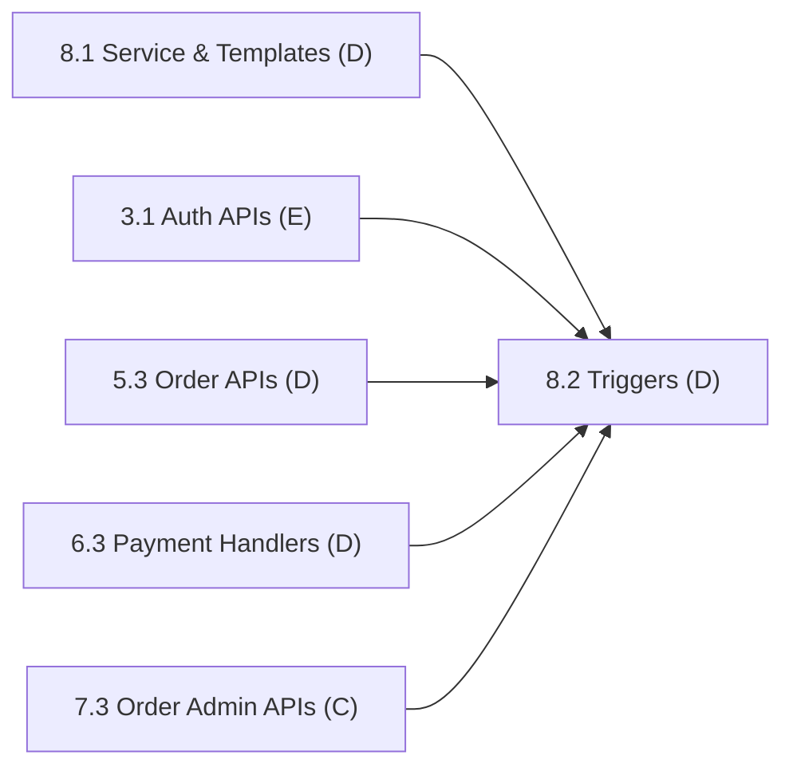

# Phase 8: Email Notifications

> **Status:** Complete (2 / 2 subphases complete)
> **Members:** D (solo)
> **Phase Dependencies:** Phase 5 (orders). 8.2 also needs 3.1, 6.3, and 7.3 for its triggers.
> **DB Schema Reference:** [DB_Schema.md](../../Database/DB_Schema.md)

---

## Overview

Transactional emails via Nodemailer. D sets up the email service, creates HTML templates, and connects email triggers to existing order, delivery, payment, and auth events. No new API endpoints: emails are triggered from existing backend logic.

---

## What's Done

- **8.1 Email Service & Templates:** Nodemailer transporter utility (`mailer.js`), styled HTML & plain-text templates (`emailTemplates.js`) for welcome, order confirmation, payment receipt, and delivery updates. Implemented `notificationService.js` with pure raw SQL queries.
- **8.2 Email Triggers Integration:** Non-blocking, fault-tolerant email triggers integrated into `authController.js` (registration), `orderController.js` (order creation), `paymentService.js` (payment completion), and `adminOrderService.js` (`onDeliveryStatusChanged`). All triggers fire strictly after database transaction commits (`COMMIT`).

---

## Subphases

| # | Subphase | Assigned | Depends On | Status |
|---|----------|----------|------------|--------|
| 8.1 | [Email Service & Templates](phase8.1-email-service-templates.md) | D | Phase 2 | Complete |
| 8.2 | [Email Triggers Integration](phase8.2-email-triggers-integration.md) | D | 8.1, 3.1, 5.3, 6.3, 7.3 | Complete |

---

## Dependency Flow

8.1 has no feature dependencies, so D can build it early (for example, while waiting on other members in Phase 6 or 7).

---

## Key Decisions & Notes

- **Cross-owner code:** 8.2 adds email calls inside endpoints owned by E (`/api/auth/register`) and C (`/api/admin/deliveries/:id/status`). D adds a single non-blocking `notificationService` call at the hook point the owner leaves, and the owner reviews the change.

---

## Related Fixes & Patches

Transactional notifications are extended by the following post-development fix item in [Docs/Fixes/overallplan.md](../../Fixes/overallplan.md):
- **[Fix 4.3: Order Delivery Mode & Courier Tracking Code Fulfillment](../../Fixes/Fix4-Role-Permissions-Operations/fix4.3-order-delivery-mode-fulfillment.md):** D updates delivery status notification email templates to conditionally render courier tracking numbers and links for courier deliveries, while displaying storefront pickup instructions for store pickup orders.

