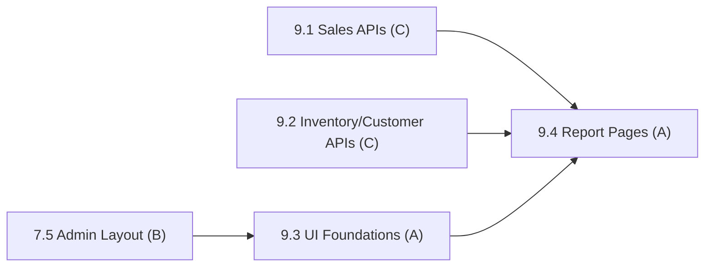

# Phase 9: Reports & Analytics

> **Status:** Complete (4 / 4 subphases complete)
> **Members:** C (backend report queries/APIs), A (frontend charts/dashboard)
> **Phase Dependencies:** 3.2 (admin guard) and 1.7 seed orders for the APIs; 7.5 (admin layout) for the UI
> **DB Schema Reference:** [DB_Schema.md](../../Database/DB_Schema.md)

---

## Overview

Business intelligence for admins. C writes SQL aggregation queries and exposes them as report APIs. A builds the data visualization UI with charts and CSV export. All report endpoints require the `admin` role.

---

## What's Done

- 9.1 Sales Report APIs — complete.
- 9.2 Inventory & Customer Report APIs + CSV Export — complete.
- **9.3 Report UI Foundations (A):** Reusable charts (`ReportLineChart`, `ReportBarChart`, `ReportDonutChart`), sortable and filterable `ReportDataTable`, `ReportDateRangePicker` with presets, `ReportExportButton` (CSV), and full routes under `/admin/reports/*`.
- **9.4 Report Pages (A):** Complete sales dashboard (revenue, top products, order volume), inventory reports (low-stock alerts, category value), and customer insights (VIP spenders, geographic distribution), with date-range filters, loading skeletons, empty states, and CSV export.

---

## Subphases

| # | Subphase | Assigned | Depends On | Status |
|---|----------|----------|------------|--------|
| 9.1 | [Sales Report APIs](phase9.1-sales-report-apis.md) | C | 3.2 | Complete |
| 9.2 | [Inventory & Customer Report APIs + CSV Export](phase9.2-inventory-customer-report-apis-csv-export.md) | C | 3.2 | Complete |
| 9.3 | [Report UI Foundations](phase9.3-report-ui-foundations.md) | A | 7.5 | Complete |
| 9.4 | [Report Pages](phase9.4-report-pages.md) | A | 9.1, 9.2, 9.3 | Complete |

---

## Dependency Flow

---

## Key Decisions & Notes

- **Refined dependencies:** Report APIs only need the admin guard (3.2) and seeded orders (1.7), so C can build them in parallel with Phase 7. Only A's UI waits for the admin layout (7.5).

---

## Related Fixes & Patches

Analytics and report visualizations are refined by the following post-development fix item in [Docs/Fixes/overallplan.md](../../Fixes/overallplan.md):
- **[Fix 5.1: Top Performing Products Chart Data Display & Label Formatting](../../Fixes/Fix5-Analytics-Reports-Visuals/fix5.1-top-performing-products-chart.md):** Updates the top performing products chart in `SalesReportPage.tsx` and backend aggregation query to prominently display real product names with tooltips instead of numeric indices.

